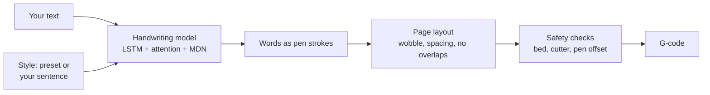

<div align="center">

# Handwrite

**Real-looking handwriting from your 3D printer.**

Type some text, pick a handwriting, and get G-code that writes it with a pen on a Bambu Lab printer.
It runs in your browser, works offline, and needs no install.


</div>

## Why

Pen-plotter tools usually write with a font. Even with a few versions of each letter, it looks like a font:
letters never join, they connect the same way every time, and the lines are perfectly straight.

Handwrite uses a neural network trained on real pen strokes ([Graves, 2013](https://arxiv.org/abs/1308.0850)).
It draws every word stroke by stroke, so letters join, vary and lift like a person's. Each line also wanders a bit,
and word gaps are never the same twice. You can even teach it your own handwriting from one sentence.

<p align="center"></p>

## Features

- **13 built-in handwriting styles**, plus your own: write one sentence with a pen, finger or mouse.
- **Neatness, line wobble, letter size, word and line spacing** controls. Gaps vary randomly around the average you set.
- **Live preview** of the page on your printer's build plate. Drag the paper to where it will sit.
- **Long text** flows onto page 2, 3, … (up to 50). Save one page or all of them as a zip.
- **Pen offset test**: print two marks, measure them with a ruler, and the app works out where your pen sits.
- **Safety first**: every move is checked against your printer's bed before the file is saved (see [Safety](#safety)).
- **Printer sounds** (A1, A1 mini, P2S) tell you when to place the paper and attach the pen.
- **Private**: everything runs on your computer. Your text and handwriting never leave the browser.

## Quick start

1. Download **`Handwrite-web.zip`** from the [latest release](https://github.com/priencelucifer/handwrite/releases/latest) and unzip it.
2. Double-click **`Handwrite.html`**. It opens in Edge, Chrome, Firefox or Safari.
3. Type your text, pick a handwriting, choose your printer and paper.
4. Click **Save G-code** and send the file to the printer like any other plain `.gcode` file.

The first time, open **Printer settings** and set your pen heights and [pen offset](#calibrate-the-pen-offset).

## Printing a page

> [!IMPORTANT]
> Take the pen **out** of the holder before you start. The printer homes first, and homing touches the nozzle to the plate.

1. **Pause 1:** the head rises and stops over where the first letter goes. Put the paper where the preview shows it and tape it down.
2. **Pause 2:** the head lowers. Slide the pen down until it touches the paper, then clamp it.
3. It writes the page. With sounds on, the A1, A1 mini and P2S play a tune at each pause and when it's done.

Do a dry run first, and stay with the printer the first time.

## Calibrate the pen offset

The pen sits a little to the side of the nozzle. The app needs to know by how much, so the writing lands where the
preview shows it and the pen never runs off the edge of the plate.

1. In **Printer settings → Pen offset**, click **Save offset test G-code** and run it.
2. Push an A4 sheet into the **top-left (far-left) corner** of the plate, with its top and left edges against the plate's edges.
3. The pen draws a long line and a short mark. Measure how far the long line is below the paper's top edge,
   and how far the short mark is from its left edge.
4. Type both numbers in and click **Save**. The offset fills in by itself.

## Supported printers and paper

| Printers | Paper |
|---|---|
| Bambu Lab A1, A1 mini, P1P / P1S, P2S, X1 Carbon / X1E | A4, A5, A6, US Letter, 4×6 in card |
| Custom (any bed size) | Custom (any size), portrait or landscape |

The G-code is plain and BambuPlot-style. It was developed on an A1; the other models use the same commands and
bed sizes from Bambu's specs.

## Safety

A wrong move can crash the print head, so the G-code is checked in layers before it is saved:

- **Settings** are range-checked. A pen-up height too close to the paper, a writing height too high for the printer,
  or borders too big for the page are refused with a plain message.
- **Every pen-down point** must be on the paper and where the pen can reach without leaving the plate, taking the pen offset into account.
- **Every coordinate written to the file** is checked once more against the bed and the P1/X1 filament-cutter corner.
- **Tests** run the output through an independent G-code simulator, including 4,000 random settings, papers and offsets.

If something is unsafe, the app refuses to save and says why. Each file starts with a comment naming the printer it is for.

## How it works



- [`engine.js`](web/engine.js) is a JavaScript port of the handwriting model. It runs in Web Workers, one word at a time,
  and is tested against the NumPy reference in [`python/model.py`](python/model.py).
- Your style works by *priming*: the model first reads strokes of a sentence written in that style, then continues in it.
- [`gcode.js`](web/gcode.js) lays words into lines and pages, keeps lines from touching, applies the pen offset, and writes the G-code.

## Project layout

```text
web/              the app: open index.html (shipped as Handwrite.html)
  app.js          interface, preview, saving
  engine.js       handwriting model (runs in Web Workers)
  gcode.js        page layout, pen offset, safety checks, G-code writer
  weights.js      model weights        (generated by tools/build-bundles.js)
  styles.js       built-in styles      (generated by tools/build-bundles.js)
  tests/          node:test suites and an independent G-code simulator
  tools/          bundle, fixture and packaging scripts
python/           NumPy reference model and the original desktop / command-line app
docs/images/      screenshots
```

## Development

No build step: edit the files in `web/` and reload the page. Tests need [Node.js](https://nodejs.org) 20 or newer:

```bash
node --test web/tests/gcode.test.js web/tests/engine.test.js
```

Build the zip for a release:

```bash
python web/tools/package.py
```

The [`python/`](python/) folder holds the older desktop and command-line version; see its [README](python/README.md).

## Limits

- The model writes letters, digits and `! " # ' ( ) , - . : ; ?`. Accents are dropped (é becomes e), capital Q, X and Z
  are written lowercase, and other characters are skipped. The app lists any it skipped.
- A word occasionally comes out garbled. Click **New version** to write the page again.

## Credits

- Model and weights: [sjvasquez/handwriting-synthesis](https://github.com/sjvasquez/handwriting-synthesis), trained on
  [IAM-OnDB](https://fki.tic.heia-fr.ch/databases/iam-on-line-handwriting-database) (academic-use data).
- Inference ported from [tibordp/kurvengefahr](https://github.com/tibordp/kurvengefahr) (GPL-2.0).
- G-code conventions from [Joep648/BambuPlot](https://github.com/Joep648/BambuPlot).

There is no license file yet. Because of the GPL-2.0 code and the academic-use training data, check both before
sharing this beyond personal use.
