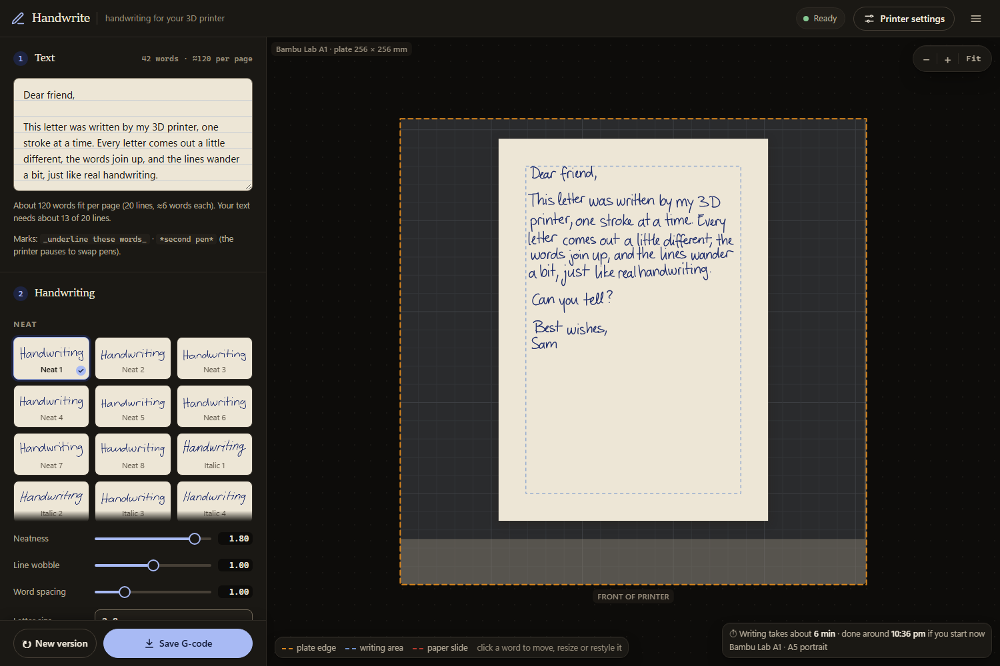
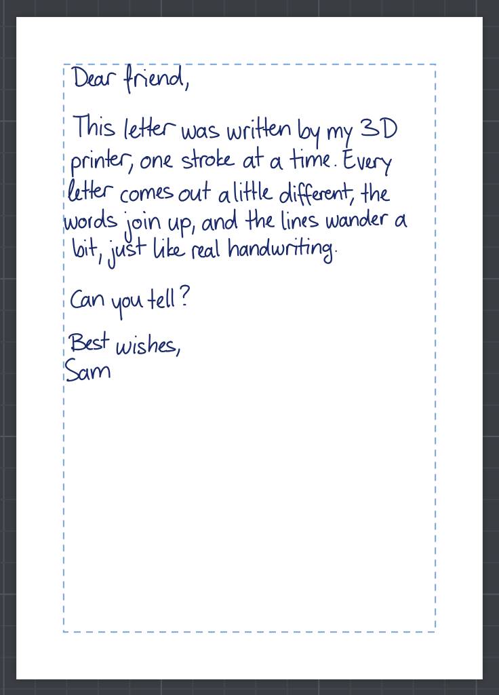
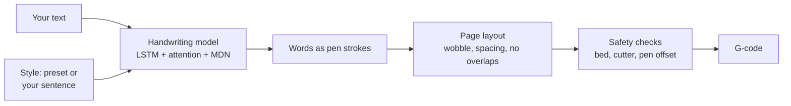

<div align="center">

# Handwrite

**Real-looking handwriting from your 3D printer.**

Type some text, pick a handwriting, and get G-code that writes it with a pen on your 3D printer: Bambu Lab, Prusa,
Creality, Voron and 400+ more.
It runs in your browser, works offline, and needs no install.

**Use it now: [handwrite.rickykashyap.top](https://handwrite.rickykashyap.top)**




</div>

## Why

Pen-plotter tools usually write with a font. Even with a few versions of each letter, it looks like a font:
letters never join, they connect the same way every time, and the lines are perfectly straight.

Handwrite uses a neural network trained on real pen strokes ([Graves, 2013](https://arxiv.org/abs/1308.0850)).
It draws every word stroke by stroke, so letters join, vary and lift like a person's. Each line also wanders a bit,
and word gaps are never the same twice.

<p align="center"></p>

## Features

- **45 handwriting styles**, neat to casual, based on 13 real writers.
- **Neatness, line wobble, letter size, word and line spacing** controls. Gaps vary randomly around the average you set.
- **Live preview** of the page on your printer's build plate. Drag the paper to where it will sit.
- **Long text** flows onto page 2, 3, … (up to 50). Save one page or all of them as a zip.
- **Lined paper**: pick the ruling and every line of writing sits on a printed line, right of the margin line.
- **Underlines and a second pen**: `_like this_` is underlined by hand, `*like this*` is written with a second pen after a pen change.
  A `*` or `_` on its own, as in `5 * 3`, is simply written.
- **Code for programming assignments**: turn on **Code** and every line and indent stays as typed. Digits and the symbols the
  model never learned (`# < > { } [ ] = + * / _ & |` and more) are drawn by hand in the page's own slant and size.
- **Header and page numbers** at the top of every sheet, written afresh each time.
- **Edit any word or line**: click it in the preview to drag it, resize it, give it another handwriting or write it again, or add
  words after it (or a line under it).
  The rest of the page stays as it is, and moved words are still checked against the paper and the pen's reach.
- **Dry run** (the pen stays 8 mm above the paper) and **start again from line N** when a pen runs dry mid-page.
- **Reach check**: a file to run with no pen and no paper. The head visits the far corners of the page's writing at
  pen-up height, slowly, so you can see the pen holder clears the bed clips, wiper and frame on a new printer.
- **Pen offset test**: print two marks, measure them with a ruler, and the app works out where your pen sits.
- **Safety first**: every move is checked against your printer's bed before the file is saved (see [Safety](#safety)).
- **Printer sounds** (A1, A1 mini, P2S): Bambu's own start and finish tunes, plus a tune when it's time to place the paper or attach the pen.
- **Private**: everything runs on your computer. Your text and handwriting never leave the browser.

## Quick start

1. Open **[handwrite.rickykashyap.top](https://handwrite.rickykashyap.top)**, or download **`Handwrite-web.zip`** from the
   [latest release](https://github.com/priencelucifer/handwrite/releases/latest), unzip it and double-click **`Handwrite.html`**.
2. It runs in Edge, Chrome, Firefox or Safari, and works offline once loaded.
3. Type your text, pick a handwriting, choose your printer and paper.
4. Click **Save G-code** and send the file to the printer like any other plain `.gcode` file.

You need a pen holder on the print head. Handwrite is set up for [**Plotter** by Elli](https://makerworld.com/en/models/1247876-plotter#profileId-1269790) (A1 and A1 mini, Stabilo pens),
free on MakerWorld.

The first time, open **Printer settings** and set your pen heights and [pen offset](#calibrate-the-pen-offset).

## Printing a page

> [!IMPORTANT]
> Take the pen **out** of the holder before you start. The printer homes first, and homing touches the nozzle to the plate.

1. **Pause 1:** the head rises and stops over where the first letter goes. Put the paper where the preview shows it and tape it down.
2. **Pause 2:** the head lowers. Slide the pen down until it touches the paper, then clamp it.
3. It writes the page. With sounds on, the A1, A1 mini and P2S play a tune at each pause and when it's done.

Do a dry run first, and stay with the printer the first time.

## Calibrate the pen offset

The pen sits a little to the side of the nozzle. The app needs to know by how much, so the writing lands where the
preview shows it and the pen never runs off the edge of the plate.

With the [Plotter holder](https://makerworld.com/en/models/1247876-plotter#profileId-1269790) the offset is **X 1, Y −25 mm**, and that's the
default, so you can skip this. For any other holder:

1. In **Printer settings → Pen offset**, click **Save offset test G-code** and run it.
2. Push an A4 sheet into the **top-left (far-left) corner** of the plate, with its top and left edges against the plate's edges.
3. The pen draws a long line and a short mark. Measure how far the long line is below the paper's top edge,
   and how far the short mark is from its left edge.
4. Type both numbers in and click **Save**. The offset fills in by itself.

## Supported printers and paper

| Printers | Paper |
|---|---|
| Bambu Lab A1, A1 mini, P1P / P1S, P2S, X1 Carbon / X1E (checked by hand) | A4, A5, A6, US Letter, 4×6 in card |
| 400+ more from [OrcaSlicer](https://github.com/OrcaSlicer/OrcaSlicer)'s profiles: Prusa, Creality, Voron, Elegoo, Qidi, Anycubic, Sovol, … | |
| Custom (any bed size) | Custom (any size), portrait or landscape |

The G-code is plain and BambuPlot-style. It was developed on an A1; the other Bambu models use the same commands and
bed sizes from Bambu's specs. For every other printer, its printable area, height, bed keep-out areas and firmware come
from OrcaSlicer's printer profiles (`web/tools/orca-printers.js` builds `web/printers.js` from them, then
`web/tools/printer-page.js` writes the [supported printers page](https://handwrite.rickykashyap.top/printers)). Klipper printers get
pauses as `G4 P` (milliseconds), which every firmware here reads, and no `G21`. Round (delta) beds, belt printers and
printers that need their own file format are left out.

## Safety

A wrong move can crash the print head, so the G-code is checked in layers before it is saved:

- **Settings** are range-checked. A pen-up height too close to the paper, a writing height too high for the printer,
  or borders too big for the page are refused with a plain message.
- **Every pen-down point** must be on the paper and where the pen can reach without leaving the plate, taking the pen offset into account.
- **Every coordinate written to the file** is checked once more against the bed and the P1/X1 filament-cutter corner.
- **The nozzle heater is switched off** right after homing, so the hotend stays cold next to the pen holder.
- **Tests** run the output through an independent G-code simulator, including 4,000 random settings, papers, offsets,
  lined paper, dry runs and pen changes.

If something is unsafe, the app refuses to save and says why. Each file starts with a comment naming the printer it is for.

## How it works



- [`engine.js`](web/engine.js) is a JavaScript port of the handwriting model. It runs in Web Workers, each writing four
  words at once so the model's weights are read from memory once for all four, and is tested against the NumPy
  reference in [`python/model.py`](python/model.py).
- Your style works by *priming*: the model first reads strokes of a sentence written in that style, then continues in it.
- [`gcode.js`](web/gcode.js) lays words into lines and pages, keeps lines from touching, applies the pen offset, and writes the G-code.

## Project layout

```text
web/              the website: index.html is the guide, app.html the app (Guide.html and Handwrite.html in the zip)
  app.js          interface, preview, saving
  engine.js       handwriting model (runs in Web Workers)
  gcode.js        page layout, pen offset, safety checks, G-code writer
  weights.js      model weights        (generated by tools/build-bundles.js)
  styles.js       built-in styles      (generated by tools/build-bundles.js)
  tests/          node:test suites and an independent G-code simulator
  tools/          bundle, fixture, guide-handwriting and packaging scripts
python/           NumPy reference model and the original desktop / command-line app
docs/images/      screenshots
```

## Development

No build step: edit the files in `web/` and reload the page. Tests need [Node.js](https://nodejs.org) 20 or newer:

```bash
node --test web/tests/gcode.test.js web/tests/engine.test.js
```

Build the zip for a release:

```bash
python web/tools/package.py
```

The [`python/`](python/) folder holds the older desktop and command-line version; see its [README](python/README.md).

## Limits

- The model writes letters and `! " ' ( ) , - . : ; ?`; the app draws digits, `# < > { } [ ] = + * / \ % & | ^ ~ _ @ $` and
  capital Q, X and Z itself. Accents are dropped (é becomes e), and other characters are skipped. The app lists any it
  skipped.
- A word occasionally comes out garbled. Click **New version** to write the page again.

## Credits

- Model and weights: [sjvasquez/handwriting-synthesis](https://github.com/sjvasquez/handwriting-synthesis), trained on
  [IAM-OnDB](https://fki.tic.heia-fr.ch/databases/iam-on-line-handwriting-database) (academic-use data).
- Inference ported from [tibordp/kurvengefahr](https://github.com/tibordp/kurvengefahr) (GPL-2.0).
- G-code conventions from [Joep648/BambuPlot](https://github.com/Joep648/BambuPlot).
- Start and finish tunes copied from the printer profiles in [Bambu Studio](https://github.com/bambulab/BambuStudio) (AGPL-3.0).
- Printer bed sizes, heights, keep-out areas and firmware from [OrcaSlicer](https://github.com/OrcaSlicer/OrcaSlicer)'s printer profiles (AGPL-3.0).

There is no license file yet. Because of the GPL-2.0 and AGPL-3.0 code and the academic-use training data, check them
before sharing this beyond personal use.
